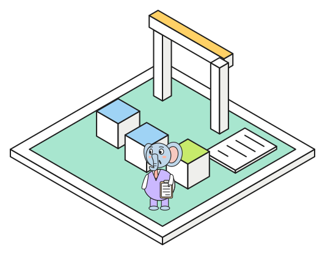

# Access as code

{.spot fig-alt="A gate with a yellow lintel, three pods, and a sheet of paper lying on a mint tile."}
Who may do what in a database tends to be configured by hand, once, and then never understood
again. The lab expresses one small access model twice, with Pulumi and with pgsesame, and applies
each to a real server, which makes the difference between the two approaches concrete.

## The model

- Two group roles that cannot log in: `app_ro` (read) and `app_rw` (read and write).
- Usage on the schema, grants on its tables and sequences.
- **Default privileges**, so tables the `app` role creates later get the same grants automatically.
  This is the part most hand-made setups forget.
- Two login users, `reporter` and `ingest`, who get access only through membership.

Tables, schemas and extensions are not part of it; they belong to the application and its
migrations.

## Pulumi: state and a diff

`pulumi/__main__.py` builds the model with `pulumi-postgresql`, a bridge of the provider Terraform
uses. `pulumi preview` diffs the program against the last applied state, and `pulumi up` applies it.

```bash
pulumi preview            # what would change
pulumi up
pulumi preview --refresh  # drift check: re-read the database first
```

Two lessons from running it: a plain `preview` compares with *state*, not with the database, so
changes made by hand only show up with `--refresh`; and the grants have to be chained with
`depends_on`, because the provider runs them in parallel and Postgres fails with "tuple
concurrently updated".

## pgsesame: one YAML file, no state

[pgsesame](https://github.com/almostly/pgsesame) declares the same model in `pgsesame/spec.yaml`.
There is no state file: `plan` reads the catalog and prints the SQL that would make it match.

```yaml
principals:
  app_ro:
    type: role
    privileges:
      schemas: {usage: [public]}
      tables: {select: [public.*]}
  reporter:
    type: user
    password_env: SESAME_REPORTER_PASSWORD
    member_of: [app_ro]

default_privileges:
  - owner: app
    schema: public
    grantee: app_ro
    tables: [select]
```

```bash
sesame plan     # exit code 2 means there are changes
sesame apply    # one transaction: 32 statements on a fresh server
sesame plan     # empty: nothing drifted
sesame import   # write a spec from what a server grants today
```

Revokes, drops and ownership changes need explicit flags, and passwords come from environment
variables, never from the file.

## Side by side

| | Pulumi | pgsesame |
|---|---|---|
| source of truth | a Python program plus a state file | one YAML spec |
| drift | detected with `--refresh` | every plan reads the database |
| apply | resources in parallel, chained by hand | one transaction |
| scope | anything with a provider, databases and beyond | Postgres roles and privileges |
| secrets | encrypted in stack config | environment variables |

Either works; do not let both manage the same roles on one server. Pulumi fits when database
access is one part of a larger infrastructure program. pgsesame fits when the database is the
whole story and you want the plan to be SQL you can read.

In the lab: `just sesame plan pg18`, `just sesame apply pg18`, and `pulumi/` for the Pulumi stack.
