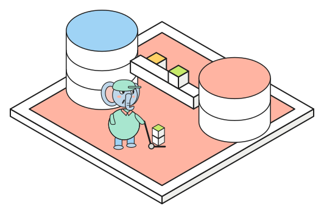

# Change data capture from Postgres to Postgres

{.spot fig-alt="Two cylinders, Postgres and a warehouse, joined by a pipe with rows travelling along it. An elephant wheels cubes of data between them."}
Change data capture (CDC) follows every committed change in a database so that another system can
stay in step with it. Pipelines are usually drawn as Postgres, then Debezium, then Kafka, then the
target, but Postgres can stream its own changes to a second Postgres with logical replication. The
source publishes a set of tables, the second server subscribes to them, and each committed insert,
update and delete arrives in commit order, about 9 ms after commit in the lab. Debezium, AWS DMS and
Redshift zero-ETL also use logical replication and can fail in the same ways.

## Setup

The source needs `wal_level = logical` (on RDS, `rds.logical_replication = 1`), and then one
statement on each side sets up the stream:

```sql
-- on the source
CREATE PUBLICATION lab_pub FOR TABLE events, documents, cdc_demo;

-- on the replica, outside a transaction
CREATE SUBSCRIPTION lab_sub
  CONNECTION 'host=db port=5432 dbname=app user=app password=...'
  PUBLICATION lab_pub;
```

A publication is only a list of tables. The subscription creates a replication slot on the source (a
bookmark of how far the subscriber has read), copies the existing rows, and then streams changes from
the slot. Since Postgres 15 a publication can also filter rows and columns, as in
`CREATE PUBLICATION p FOR TABLE events (id, kind) WHERE (kind = 'purchase')`.

The replica finds the row for each update and delete by its primary key or `REPLICA IDENTITY`, so
every published table needs one. The replica must also already have the tables, because **DDL is
never replicated**. A `vector` column comes across unchanged as long as both sides have pgvector.

## Failure modes

### Unread slots and WAL retention

A slot that nobody reads never advances, and Postgres cannot recycle its write-ahead log (WAL) past
it. With the subscription disabled and 20,000 rows written, 7 MB of WAL stayed on the source until
the subscription was enabled again, which is how a forgotten Debezium connector fills a disk in
production. `max_slot_wal_keep_size` limits the damage by invalidating a slot that holds more than
the cap, after which the subscriber has to start over but the primary keeps its disk.

### Schema changes on the source

When a column is added on the source and a row is written, the apply worker on the replica cannot fit
that row into its table. It logs an error and retries indefinitely, and nothing after that row
arrives until the column is added on the replica as well. Schema changes therefore go to the
subscriber first and the publisher second, since an extra column on the replica does no harm.

### Writes on the replica

The replica accepts writes. A row written directly on it collides with the same key arriving from
the source, and the apply worker stops on the unique violation until the row is deleted or
`ALTER SUBSCRIPTION ... SKIP (lsn = ...)` skips the change. Postgres 18 counts conflicts of each
type in `pg_stat_subscription_stats`.

## Sequences and slots

Sequences are not replicated, so their counters on the replica never move and have to be reset with
`setval` after a failover. Before Postgres 17, replication slots did not survive a failover either,
and Postgres 17 added failover slots.

::: {.callout-tip}
## Choosing a CDC tool

Logical replication fits when the target is Postgres and the data needs no transformation, and
Debezium fits when there are several consumers or the target is another kind of system. For an
analytical target that reads the stream itself, Apache Doris has [built-in CDC](doris.qmd).
:::
