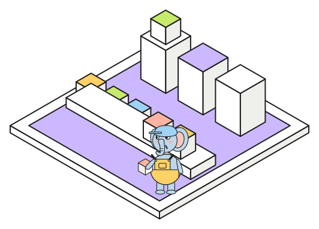

# A job queue that is just a table

{.spot fig-alt="Coloured job cubes waiting on a conveyor in front of three worker blocks, one of which carries a job on its roof."}
A job queue lets an application hand slow work, such as fetching and embedding a web page, to
background workers and answer the request straight away. The usual tools for this are Redis or
RabbitMQ, a second system to run next to the database. [PgQueuer](https://github.com/janbjorge/pgqueuer)
keeps the queue in Postgres instead, as an ordinary table with one row per job.

Three Postgres features make that work:

- **`FOR UPDATE SKIP LOCKED`** lets a worker claim rows that no other worker has locked, so any
  number of workers can pull from one table without two of them getting the same job.
- **`LISTEN` / `NOTIFY`** is a message channel inside Postgres. A trigger sends a notification on
  every insert, so idle workers wake within milliseconds instead of polling the table.
- **Transactions** cover the queue too. A job enqueued in the same transaction as the data it
  refers to exists only if that data was committed.

## How a worker claims a job

A worker takes jobs in one short statement. It selects the oldest waiting rows with
`FOR UPDATE SKIP LOCKED`, sets their status to `picked`, and commits. The row lock lasts only for
that statement. While the job runs, nothing is locked: the row is just marked as `picked`.

Crashes are handled by a second column. Each worker keeps a `heartbeat` column fresh while it
works. When a job's heartbeat is older than `heartbeat_timeout` (30 s by default), the next worker
that looks for jobs takes it over. A crashed worker's jobs therefore come back on their own, shortly
after its heartbeats stop.

## Watching a real run

The scene below replays real runs. The lab's `POST /queue/trace` endpoint starts pgqueuer workers on
their own connections, enqueues jobs, and records each insert, each notification and each attempt.

::: {#queue-frame .viz .scene .column-body-outset data-src="../viz/queue.html?preset=skip&embed=1" data-poster="../images/queue.gif" data-title="A pgqueuer run, replayed"}
:::

::: {.chips .column-body-outset}
<a href="#queue-frame" onclick="playScene('queue-frame', '../viz/queue.html?preset=skip&embed=1')">SKIP LOCKED</a>
<a href="#queue-frame" onclick="playScene('queue-frame', '../viz/queue.html?preset=notify&embed=1')">NOTIFY</a>
<a href="#queue-frame" onclick="playScene('queue-frame', '../viz/queue.html?preset=limit&embed=1')">Limit</a>
<a href="#queue-frame" onclick="playScene('queue-frame', '../viz/queue.html?preset=retry&embed=1')">Retries</a>
<a href="#queue-frame" onclick="playScene('queue-frame', '../viz/queue.html?preset=priority&embed=1')">Priority</a>
<a href="../viz/queue.html" target="_blank">Open full screen</a>
:::

Python inserts jobs on the far side, and each job becomes one cell in the `pgqueuer` table. Every
notification spreads as a ring from the table, and idle workers flash when it reaches them. While a
worker holds a job, its row lights up in that worker's colour and the job rides on the worker's
roof. When the job finishes, pgqueuer deletes the row and it drops into the `pgqueuer_log` strip at
the front.

| preset | what to watch |
|---|---|
| SKIP LOCKED | 24 jobs and 3 workers taking 2 at a time: three colours share the table, never the same row |
| NOTIFY | one `INSERT` per job: each ring wakes an idle worker, which picks the row within milliseconds |
| Limit | `concurrency_limit = 2` across 3 workers: the picked counter never goes above 2 |
| Retries | 30% of attempts fail: peach rows wait out a delay that doubles before each new attempt |
| Priority | one worker, one job at a time: tall rows (high priority) go first, whatever order they arrived in |

## What the library adds

The table and the claim are the whole queue. On top of them, pgqueuer gives the features an
application needs in practice:

- **Dedupe keys.** Enqueueing a key that a waiting job already has does nothing, so running the
  same ingest twice queues no extra work.
- **Retries with backoff.** With `on_failure="hold"`, a job that runs out of attempts stays in the
  table as `failed`, where you can inspect it and requeue it with `pgq requeue`.
- **Concurrency limits** that the database enforces across all workers, not per process.
- **Schedules**, written as cron expressions and run by whichever worker gets there first.

The lab's `app/jobs.py` runs the documentation ingest this way, with one job per page:

```python
def retrying(params: EntrypointExecutorParameters) -> DatabaseRetryEntrypointExecutor:
    return DatabaseRetryEntrypointExecutor(params, max_attempts=3, backoff_multiplier=2.0)

@pgq.entrypoint("ingest_page", concurrency_limit=2, on_failure="hold", executor_factory=retrying)
async def run_ingest_page(job: Job, ctx: Context) -> None:
    await ingest_page(job.payload.decode(), ctx.resources["http"], ctx.resources["model"])

await queries.enqueue(
    ["ingest_page"] * len(pages),
    [p.encode() for p in pages],
    [0] * len(pages),                               # priorities
    dedupe_key=[f"ingest_page:{p}" for p in pages],
    on_conflict="skip",
)
```

Two workers ingest all 20 pages (407 chunks) in about 18 s, and most of that time goes on loading
the embedding model.

::: {.callout-warning}
## Use asyncpg for the workers

pgqueuer can run on psycopg or asyncpg. On psycopg, a worker waiting for notifications keeps its
connection busy for up to a second, and the worker's other queries wait behind it. With a
concurrency limit, five trivial jobs took 15 s on psycopg and 0.07 s on asyncpg.
:::

Notebook: [pgqueuer taken apart](../notebooks/pgqueuer_playground.ipynb), where the workers run as
asyncio tasks inside the notebook. The [next chapter](pgmq.qmd) looks at a different queue design.
