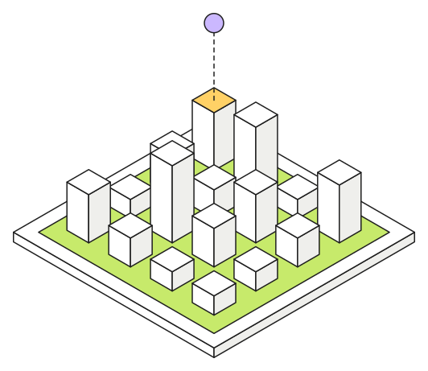

# Vectors in Postgres

{.spot fig-alt="A grid of white towers on a lime tile; a violet ball floats above the yellow-topped tower, joined to it by a dashed line."}
Semantic search turns each passage of text into an embedding, a list of numbers, and answers a
question with the passages whose embeddings lie closest to the question's. [pgvector](https://github.com/pgvector/pgvector)
does this inside Postgres. It adds a `vector` type, four distance operators and two index types.

With pgvector, "find the passages most similar to this question" is an `ORDER BY ... LIMIT`. The
embeddings sit in the same table as the text, the permissions and the foreign keys, so there is no
second store to keep in sync. This chapter covers the query side, and the next one compares the
indexes.

## Four distances

Each operator measures closeness in a different way, and each needs its own index operator class
(the opclass), which comes up again below:

| SQL | SQLAlchemy | what it is | index opclass |
|---|---|---|---|
| `a <-> b` | `col.l2_distance(b)` | Euclidean distance | `vector_l2_ops` |
| `a <=> b` | `col.cosine_distance(b)` | 1 minus the cosine: 0 same direction, 2 opposite | `vector_cosine_ops` |
| `a <#> b` | `col.max_inner_product(b)` | the negative inner product (so smaller is closer) | `vector_ip_ops` |
| `a <+> b` | `col.l1_distance(b)` | taxicab distance | `vector_l1_ops` |

Most embedding models produce normalized vectors, of length 1. For those, cosine and inner product
put results in the same order, and inner product skips a division. The notebook starts with a dozen
hand-made three-dimensional vectors whose axes mean something (`[fruit, tech, sport]`), so you can
predict each distance in your head before Postgres computes it.

## Nearest neighbours

A similarity query is an ordinary `SELECT` ordered by distance. Filters, joins and labels are
added around that core:

```python
distance = Document.embedding.cosine_distance(query_vec).label("distance")
stmt = (
    select(Document.title, distance)
    .where(Document.category == "orm")  # ordinary filters first
    .order_by(distance)
    .limit(5)
)
```

Two refinements come up in most real systems. The first is **retrieve, then rerank**: a CTE takes
the top 50 by vector distance, and the outer query orders those 50 by a blended score, such as
similarity with popularity or recency, or a cross-encoder. The second is **top-k per group**:
`row_number() OVER (PARTITION BY category ORDER BY distance)` numbers the rows within each category,
and the query keeps the first three of each.

## Upserting embeddings

Embedding pipelines run again whenever the source text changes. `INSERT ... ON CONFLICT DO UPDATE`
on a unique key handles both cases in one statement: it inserts new rows and refreshes the ones
that already exist.

```python
stmt = insert(Document).values(rows)
stmt = stmt.on_conflict_do_update(index_elements=["name"], set_={"embedding": stmt.excluded.embedding})
```

## An index changes the answer

Without an index, Postgres computes the distance to each row and sorts them. The answer is exact,
and the cost is acceptable up to some tens of thousands of rows. An approximate nearest-neighbour
index is much faster but *slightly wrong*, and how wrong is a setting. Two details of these indexes
often cost people hours:

::: {.callout-warning}
## The opclass must match the operator

An HNSW index built with `vector_l2_ops` is ignored by a query that orders by `<=>`. The plan
quietly goes back to a sequential scan. Check with `EXPLAIN` after each index change.
:::

::: {.callout-warning}
## Filters run after the walk

HNSW collects `hnsw.ef_search` candidates first and applies `WHERE` afterwards. A filter that keeps
10% of rows throws most candidates away, and the query can return fewer rows than its `LIMIT`.
pgvector 0.8 added iterative scans, which keep walking the graph until the limit is met:
`SET hnsw.iterative_scan = relaxed_order`.
:::

## Try it here

The console below is a real Postgres with pgvector 0.8. `items` holds a dozen vectors whose three
axes mean `[fruit, tech, sport]`, and `docs` holds 2,000 random 16-dimensional ones for the index
examples. Each chip loads a query and runs it. You can also edit the SQL and press Run to try your
own.

::: {.viz .console .column-page}
<iframe src="../viz/sql.html?lab=vectors&embed=1" loading="lazy" title="pgvector SQL console"></iframe>
:::

::: {.viz-caption .column-page}
Postgres 18 compiled to WebAssembly ([PGlite](https://pglite.dev)), running in this tab: the first
load fetches about 10 MB, then it starts in a second or two. Your edits stay in the tab, and Reset data
starts over. [Open full screen](../viz/sql.html?lab=vectors){target="_blank"}.
:::

## The doc-search app

The lab's FastAPI app is this chapter in production form. `app/ingest.py` fetches 20 pages of the
SQLAlchemy documentation and splits them by section into chunks of about 250 words. It embeds each
chunk with `BAAI/bge-small-en-v1.5` (384 dimensions, ONNX on the CPU) and stores the 407 rows with
an HNSW index.

`POST /ask` embeds the question and takes the five chunks closest by cosine distance. It then builds
an extractive summary from their sentences, so nothing is generated and each answer carries its
sources. Retrieval takes about 20 ms. The [sync and async scene](sqlalchemy.qmd#watching-it-happen)
shows those queries in flight, with the chunks laid out by a PCA of their real embeddings.

Notebook: [pgvector playground](../notebooks/pgvector_playground.ipynb), run on pg18. It covers
everything above, plus the index comparison of the next chapter.
