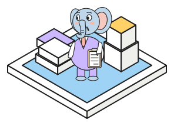

# Welcome {.unnumbered}

{.column-body-outset .hero fig-alt="An isometric ink drawing of cartoon elephants at work around a Postgres database. One sends jobs from a laptop onto a belt, one picks a job off the belt, one carries it up a ramp into a hatch on the database, one inspects the hatch with a magnifying glass, one repairs the database with a wrench, one wheels cubes of data away, one stacks them on a pile and one checks them off on a clipboard."}

Applications usually keep their data in Postgres and use other systems, such as a
queue for background jobs or a vector store for semantic search, to manage supporting tasks.
This book shows how Postgres can do each of these jobs itself by leveraging the ecosystem of Postgres.

## The map

{.column-body-outset .hero fig-alt="An isometric ink drawing of the book as a small world. A Postgres cylinder stands at the center of a plate, and five districts around it stand for Python, Search, Queues, Moving data, and Access and operations."}

::: {.map}
::: {}
**Postgres from Python**

Using SQLAlchemy to talk to Postgres in sync and async code, JSONB for document storage, leveraging PgBouncer for connection management, PGlite as an in-process Postgres database.
:::
::: {}
**Search**

Using `pgvector` to compare and index embeddings, differences between the HNSW, DiskANN and PRISM indexes, graph retrieval next to vectors, loading and reading vectors in bulk.
:::
::: {}
**Queues**

Using `pgqueuer` for Postgres job queues, building a message queue on a visibility
timeout with `pgmq`.
:::
::: {}
**Moving data**

Performing logical replication to copy changes to a second Postgres, using Apache Doris with Postgres to run a change data capture (CDC) job,
building a Postgres lakehouse with `pg_ducklake`.
:::
::: {}
**Access and operations**

Using Pulumi and `pgsesame` to manage roles and grants as code, Supabase as a backend built from Postgres features.
:::
:::

::: {.panel}
### Slonik, the Postgres elephant

{.spot fig-alt="An elephant in a violet waistcoat holds a clipboard on a small blue tile, between a stack of letters and a crate of data."}
The Postgres elephant is called **Slonik**, Russian for "little elephant". In 1997, when the
project was looking for a mascot, David Yang suggested an elephant on the pgsql-hackers mailing
list, after Agatha Christie's *Elephants Can Remember*. The first drawing came from St. Petersburg
in April 1999. Dmitry Samersov of the WebPlus studio posted a website mockup with an elephant in a
diamond, sketched by the designer Ekaterina Papchinskaya, who saved it as `slonik.gif`, and the
name stuck. Daniel Lundin later redrew the elephant as a vector image without the diamond, and his
version became the official logo with the new postgresql.org website in late 2004.

When Jan Wieck, who was writing a replication system, asked what `slonik` meant, Oleg Bartunov
answered "little elephant", and the plural, *slony*, became the name of Slony-I. In
March 2025 Samersov transferred the rights to the 1999 drawing to the community under a Creative
Commons license. The elephants in this book are drawn for it and are not the Slonik logo, which is
a registered trademark of the PostgreSQL Community Association of Canada.[^logo]
:::

[^logo]: Oleg Bartunov's [account of the logo](https://habr.com/en/companies/postgrespro/articles/907746/)
  on Habr, and the [PostgreSQL wiki](https://wiki.postgresql.org/wiki/Logo).

## How to read it

Chapters 1 and 9 include scenes that replay a recorded run of the lab's app. In
[Chapter 1](chapters/sqlalchemy.qmd) it visualizes sync and async vector searches, and
[Chapter 9](chapters/pgqueuer.qmd) illustrates the queueing mechanics. The pgvector, graph, JSONB and pgmq chapters
provide a SQL console, where you can run queries against Postgres.

::: {.callout-tip}
## Run it yourself

Clone the repository, then run `cp .env.example .env`, `uv sync` and `just db` to start Postgres 16
with pgvector on `localhost:5432`. A few notebooks need another server, and
[Running the lab](chapters/running-the-lab.qmd) lists them.
:::
